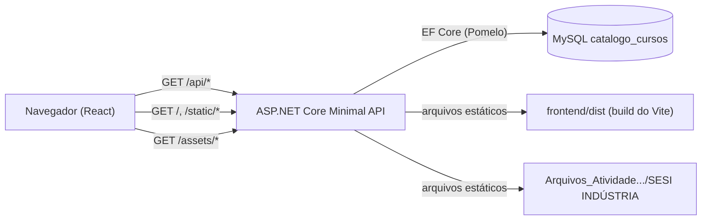

# Catálogo de Cursos CTED

## Objetivo da aplicação

Aplicação web para consulta do catálogo de cursos do CTED (SESI Indústria), baseada no protótipo Figma "[TEST DEV] SESI Indústria". O usuário pode listar cursos, pesquisar por nome, combinar filtros (categoria, modalidade e status), ver o número de resultados e abrir os detalhes de cada curso. A aplicação é **somente leitura**: não há rotas de cadastro, edição ou exclusão.

## Tecnologias utilizadas

| Camada | Tecnologia |
|---|---|
| Back-end | C# / .NET 8 (ASP.NET Core Minimal API) |
| ORM | Entity Framework Core 8 + Pomelo.EntityFrameworkCore.MySql 8.0.2 |
| Banco de dados | MySQL 8 (código aberto — Community Server, administrado via MySQL Workbench) |
| Front-end | React 18 + Vite 5 (JavaScript/JSX), CSS3 vanilla com custom properties |
| Tipografia / assets | Open Sans e ícones/imagens exportados do Figma (pasta `SESI INDÚSTRIA`) |

## Arquitetura da solução



- **Produção / execução simples:** um único processo .NET serve a API, o build do React (`frontend/dist`) e os assets do Figma, na mesma origem (sem CORS).
- **Desenvolvimento:** `npm run dev` sobe o Vite em `http://localhost:5173` com hot reload; o Vite encaminha (proxy) `/api` e `/assets` para a API em `http://localhost:5080`. CORS para `5173` também está liberado caso se use `VITE_API_BASE`.
- Filtros de categoria/modalidade/status são executados no banco (com índices). A busca por nome é feita após a consulta, com normalização que ignora maiúsculas e acentos ("matematica" encontra "Matemática").
- Erros não tratados viram respostas `application/problem+json` (503 para banco indisponível), que o front exibe de forma amigável.

## Estrutura das pastas

```
.
├── README.md
├── USO_DE_IA.md
├── backend/
│   └── CatalogoCursos.Api/
│       ├── Program.cs              # configuração, middlewares e endpoints
│       ├── appsettings.json        # connection string MySQL, caminhos e CORS
│       ├── Data/
│       │   ├── CatalogoContext.cs  # DbContext + mapeamento
│       │   └── SeedData.cs         # 8 cursos fictícios
│       ├── Models/Curso.cs         # entidade
│       └── Properties/launchSettings.json
├── frontend/
│   ├── index.html                  # entrada do Vite
│   ├── package.json
│   ├── vite.config.js              # proxy de dev e saída do build
│   └── src/
│       ├── main.jsx
│       ├── App.jsx                 # estado, busca com debounce, filtros na URL
│       ├── api.js                  # cliente HTTP (timeout, cancelamento, erros)
│       ├── styles.css
│       └── components/             # Header, Footer, Filtros, CursoCard, CursoModal, Estado
└── Arquivos_Atividade prática_519_2026_DEV/
    └── SESI INDÚSTRIA/             # imagens e ícones do Figma (servidos em /assets)
        └── _Font/                  # Open Sans (servida em /assets/_Font)
```

## Instruções para execução (incluindo local)

**Pré-requisitos:**
- [.NET SDK 8](https://dotnet.microsoft.com/download/dotnet/8.0) (testado com 8.0.202)
- [Node.js](https://nodejs.org/) 18+ (testado com 24.x / npm 11)
- [MySQL Server 8](https://dev.mysql.com/downloads/mysql/) em execução (serviço `MySQL80`)

**1. Inicie o MySQL** (PowerShell como Administrador) ou pelo Workbench em *Server → Startup/Shutdown*:

```powershell
Start-Service MySQL80
```

**2. Ajuste a connection string**, se seu usuário/senha forem diferentes, em `backend/CatalogoCursos.Api/appsettings.json` (ou via variável `ConnectionStrings__Catalogo`).

**3. Instale e gere o front-end:**

```powershell
cd frontend
npm install
npm run build
```

**4. Rode a API:**

```powershell
cd backend/CatalogoCursos.Api
dotnet run --launch-profile http
```

Acesse **http://localhost:5080** — interface, API e assets no mesmo endereço.

**Modo desenvolvimento do front (opcional):** com a API rodando, execute `npm run dev` em `frontend/` e acesse **http://localhost:5173**.

Na primeira execução o banco `catalogo_cursos` e a tabela `Cursos` são criados automaticamente com o seed. Para recriar os dados, rode `DROP DATABASE catalogo_cursos;` no Workbench e reinicie a API.

> A pasta `Arquivos_Atividade prática_519_2026_DEV` deve permanecer na raiz do projeto, pois imagens, ícones e fontes são lidos dela (caminho configurável em `appsettings.json` → `Paths:Assets`).

## Configuração do banco

- **SGBD:** MySQL 8 (`localhost:3306`), banco `catalogo_cursos`.
- **Connection string:** `appsettings.json` → `ConnectionStrings:Catalogo`
  (`Server=localhost;Port=3306;Database=catalogo_cursos;User=root;Password=...;`). Pode ser sobrescrita por variável de ambiente: `ConnectionStrings__Catalogo`.
- **Provider:** Pomelo com `MySqlServerVersion(8.0)` fixo (não precisa conectar no startup para detectar a versão) e `EnableRetryOnFailure(3)`.
- **Criação/seed:** `Database.EnsureCreated()` na inicialização + `HasData(SeedData.Cursos)`.
- **Seed:** 8 cursos, 4 categorias (Matemática, Linguagens, Ciências da Natureza, Sustentabilidade), 3 modalidades (EAD, Presencial, Híbrido), 3 status (Inscrições abertas, Em breve, Encerrado), cargas de 20h a 160h e 6 públicos-alvo distintos.
- Se o banco estiver inacessível (ex.: serviço `MySQL80` parado), a API continua no ar e responde `503`.

> Em produção, não versionar a senha: use variáveis de ambiente ou *user-secrets*.

## Endpoints

Todos são `GET` e retornam JSON (camelCase).

| Rota | Descrição |
|---|---|
| `/api/cursos` | Lista todos os cursos, ordenados pelo nome. |
| `/api/cursos?busca={texto}` | Busca por nome completo ou breve (ignora maiúsculas e acentos). |
| `/api/cursos?categoria=&modalidade=&status=` | Filtros combináveis entre si e com `busca`. |
| `/api/cursos/{id}` | Detalhe de um curso (`404` se não existir). |
| `/api/filtros` | Valores distintos de categorias, modalidades e status (para popular os filtros). |
| `/api/health` | Verificação de saúde do banco (`200` ou `503`). |

Exemplo:

```
GET /api/cursos?categoria=Sustentabilidade&modalidade=EAD&status=Encerrado
```
```json
{ "total": 1, "itens": [ { "id": 8, "nomeCompleto": "Sustentabilidade e ESG no Dia a Dia da Fábrica", "nomeBreve": "ESG na Fábrica", "categoria": "Sustentabilidade", "modalidade": "EAD", "cargaHoraria": 24, "status": "Encerrado", "imagemApresentacao": "/assets/hero-image.png", "dataDisponibilizacao": "2025-06-02", "...": "..." } ] }
```

Erro (banco indisponível):
```json
{ "type": "...", "title": "Banco de dados indisponível", "status": 503, "detail": "Não foi possível carregar os cursos no momento. Tente novamente em instantes." }
```

## Modelo de dados

Tabela `Cursos` (MySQL):

| Campo | Tipo | Observação |
|---|---|---|
| Id | INT (PK, auto incremento) | |
| NomeCompleto | VARCHAR(200) | obrigatório |
| NomeBreve | VARCHAR(80) | obrigatório |
| Descricao | VARCHAR(2000) | obrigatório |
| Categoria | VARCHAR(60) | indexado |
| Modalidade | VARCHAR(30) | indexado |
| CargaHoraria | INT | em horas |
| PublicoAlvo | VARCHAR(200) | |
| Status | VARCHAR(30) | indexado |
| ImagemApresentacao | VARCHAR(300) | caminho público (`/assets/...`) |
| DataDisponibilizacao | DATE | |

## Estratégia de responsividade

- Layout fluido com `width: min(1200px, 100% - 2rem)` e tipografia com `clamp()`.
- Grade de cards com `repeat(auto-fill, minmax(min(100%, 300px), 1fr))`: 1 coluna no mobile, 2–3 em tablet, 3–4 no desktop, sem media queries para o grid.
- Filtros em `auto-fit` (lado a lado no desktop) e empilhados em uma coluna abaixo de 640px, com botão "Limpar filtros" em largura total.
- No mobile o gradiente do hero passa a vertical para garantir contraste do texto sobre a foto; o selo do cabeçalho é ocultado.
- Diálogo de detalhes limitado a `100dvh - 2rem` com rolagem interna.
- Imagens com `object-fit: cover`, `aspect-ratio` fixo (evita layout shift) e `loading="lazy"` nos cards.

## Decisões de acessibilidade

- HTML semântico (`header`, `main`, `section`, `footer`, `nav`, `dialog`, `dl`), um único `h1` e hierarquia de títulos.
- Link "Pular para o conteúdo"; todos os campos com `<label>` associado; busca em `form role="search"`.
- Cards são `<button>` (acessíveis por teclado, Enter/Espaço) com `aria-haspopup="dialog"`.
- Detalhes em `<dialog>` nativo com `showModal()`: foco preso no modal, fechamento por Esc, clique no fundo ou botão com `aria-label`; o foco retorna ao card de origem.
- Contador com `role="status"`/`aria-live="polite"`; erro com `role="alert"`; lista com `aria-busy` durante o carregamento; skeletons com `aria-hidden`.
- Foco visível (`:focus-visible`) com contorno de 3px; áreas de toque ≥ 44px.
- Cores com contraste AA e status comunicado por texto, não só por cor.
- Imagens decorativas com `alt=""`; imagem do detalhe com texto alternativo; `prefers-reduced-motion` desativa animações; `lang="pt-BR"`.
- O React escapa todo conteúdo dinâmico por padrão (proteção contra XSS).

## Processo de publicação

```powershell
cd frontend
npm ci
npm run build

cd ../backend/CatalogoCursos.Api
dotnet publish -c Release -o ../../publish
```

Copie para o servidor a pasta `publish/`, a pasta `frontend/dist` e a pasta de assets, ajustando `Paths:Frontend` e `Paths:Assets` (via `appsettings.Production.json` ou variáveis `Paths__Frontend` / `Paths__Assets`) e a `ConnectionStrings__Catalogo` do MySQL de produção. Execute `dotnet CatalogoCursos.Api.dll` atrás de um proxy reverso (IIS, Nginx) ou em contêiner/App Service. Para produção recomenda-se usar migrations em vez de `EnsureCreated` e um usuário MySQL com permissão apenas de leitura.

## Limitações conhecidas

- Sem paginação (volume de dados pequeno); a busca por nome é feita em memória após os filtros SQL — para grandes volumes, criar coluna normalizada indexada ou usar índice FULLTEXT.
- `EnsureCreated` não suporta evolução de schema (seria necessário adotar migrations).
- A senha do MySQL está no `appsettings.json` apenas para facilitar a avaliação local.
- Só existem 3 imagens de curso no protótipo, por isso elas se repetem entre cursos. As PNGs originais têm 2,5–3,8 MB e não foram otimizadas.
- Sem testes automatizados de front-end (validação manual e via chamadas HTTP).

## Testes executados

| # | Cenário | Resultado |
|---|---|---|
| 1 | `npm run build` (Vite) | build gerado em `frontend/dist` sem erros |
| 2 | `dotnet build` com Pomelo/MySQL | 0 avisos, 0 erros |
| 3 | `GET /api/health` com MySQL ativo | `200 {"status":"ok"}` — banco e seed criados automaticamente |
| 4 | `GET /api/cursos` | 8 cursos retornados do MySQL |
| 5 | Busca `?busca=matematica` (sem acento) | `total: 1` — "Matemática Aplicada à Indústria 4.0" |
| 6 | Três filtros: Sustentabilidade + EAD + Encerrado | `total: 1` (ESG na Fábrica) |
| 7 | `/api/filtros` | 4 categorias, 3 modalidades, 3 status |
| 8 | `/api/cursos/999` | `404` |
| 9 | `/` (build React) e `/assets/hero-image.png` | 200 OK |
| 10 | Banco indisponível (serviço MySQL parado) | API responde `503` com ProblemDetails; front exibe estado de erro com "Tentar novamente" |
| 11 | Responsividade mobile/desktop | Validado manualmente (DevTools, modo dispositivo) — layout se adapta corretamente |
